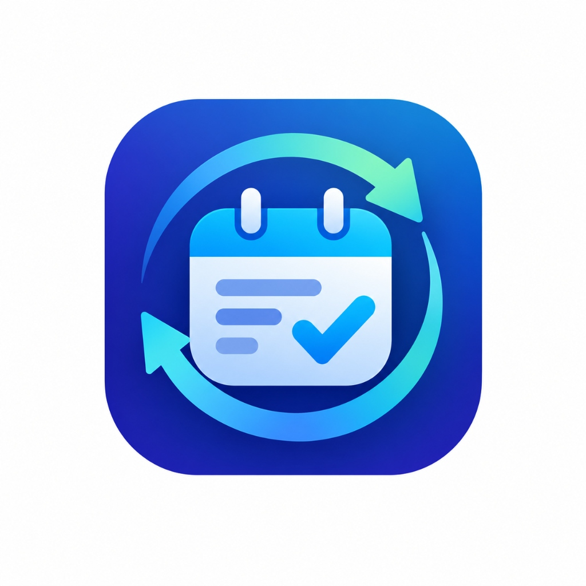

# DueSync

<p align="center">
  
</p>

> **Stay ahead of every deadline.**  
> A unified deadline tracking system tailored for students and busy developers.

DueSync combines two interfaces:
1. **DueSync Web**: A responsive, mobile-first visual dashboard designed with a calm, tactile pastel-bento aesthetic, featuring live countdowns, circular progress tracking, 7-day workload curves, urgency badges, and zero-build local storage.
2. **DueSync CLI (`duelist`)**: A terminal command-line tool with interactive REPL, export reports (`.docx` & `.md`), and Google Sheets synchronization.

---

## Repository Structure

```
DueSync/
├── README.md                   # Project documentation & quick start
├── .gitignore                  # Git ignore rules
├── duesync-master-spec.md      # Specification file
├── web/
│   └── index.html              # Self-contained Web dashboard (single file)
└── cli/
    ├── pyproject.toml          # Python package configuration & `duelist` entrypoint
    ├── requirements.txt        # Runtime and test dependencies
    ├── duelist/
    │   ├── __init__.py
    │   ├── tracker.py          # CLI commands & interactive REPL
    │   ├── storage.py          # Atomic JSON persistence & corruption backup
    │   ├── status.py           # Single source of truth for urgency and colors
    │   ├── export.py           # .docx and .md report generator
    │   └── sheets.py           # Google Sheets sync with batch formatting
    └── tests/
        ├── test_storage.py     # Persistence, corruption handling, and atomic writes
        ├── test_status.py      # Urgency logic and color mappings
        ├── test_dates.py       # Relative and rollover date parsing
        └── test_export.py      # Document export & categorization tests
```

---

## 1. DueSync Web

### Features
- **Zero build step**: Single `web/index.html` file using Tailwind CSS CDN, Lucide Icons, and Google Fonts (Inter).
- **Responsive Layout**: Designed mobile-first for phones (390px), tablets (768px), and desktop widescreen (1440px+).
- **Urgency Classification**: Real-time evaluation into **Overdue**, **Due Today**, **Approaching Soon**, and **Plenty of Time**.
- **Live Tabular Countdowns**: Accurate countdown tickers refreshed every 60 seconds.
- **Search, Filter & Sort**: Multi-criteria search, 5 filter tabs with real-time task counts, and 3 sort modes.
- **Accessible & Safe**: Full keyboard navigation, inline form validation, character counter, focus trapping, and strict HTML escaping.

### Quick Start
Open `web/index.html` directly in any web browser:
```bash
# Double-click web/index.html or run:
start web/index.html
```
Or serve locally via Python:
```bash
python -m http.server 8080 --directory web
# Open http://localhost:8080 in your browser
```

---

## 2. DueSync CLI (`duelist`)

### Installation
From the root directory:
```bash
python -m pip install -e ./cli
```

### Usage Modes

#### 1. Direct Command-Line Execution
```bash
# Add a deadline
python -m duelist add "Data Structures Lab" --class "CS 101" --due "tomorrow"

# Add with flexible date syntax (auto rolls over past dates to next year)
python -m duelist add "Physics Midterm" --class "Physics" --due "June 20"

# List all deadlines sorted by date with terminal colors
python -m duelist list

# View upcoming deadlines due within the next 7 days
python -m duelist upcoming

# Mark a deadline complete
python -m duelist done 1

# Delete a deadline by ID
python -m duelist remove 2

# Export weekly summary as Markdown
python -m duelist export --format md

# Export weekly summary as styled Word Document (.docx)
python -m duelist export --format docx

# Synchronize with Google Sheets
python -m duelist sync
```

#### 2. Interactive REPL Mode
Launch without arguments to enter the interactive shell:
```bash
python -m duelist
```
```
============================================================
 DueSync CLI (duelist) · Stay ahead of every deadline.
 Type a command (e.g. 'list', 'add --help') or 'help' or 'exit'.
============================================================
duelist> list
duelist> add "Final Presentation" --class "Capstone" --due "next friday"
duelist> upcoming
duelist> done 3
duelist> exit
```

---

## 3. Google Sheets Integration

DueSync supports synchronizing your local deadlines directly to a Google Sheet with automated table formatting and status color highlights.

### Setup Instructions
1. Go to the [Google Cloud Console](https://console.cloud.google.com/).
2. Create a project and enable both the **Google Sheets API** and **Google Drive API**.
3. Create a **Service Account**, generate a JSON key, and save it as `credentials.json` in your working directory.
4. Open your target Google Spreadsheet in your browser and share it with the service account client email address (found inside `credentials.json`) with **Editor** permissions.
5. Run the sync command:
   ```bash
   python -m duelist sync
   ```
6. On first run, enter the Spreadsheet ID (found in the sheet URL: `https://docs.google.com/spreadsheets/d/<SPREADSHEET_ID>/edit`). The ID is automatically saved to `config.json` for future runs.

---

## 4. Testing

Run the automated test suite using `pytest`:
```bash
python -m pytest cli/tests
```
All 16 unit tests cover:
- JSON persistence, atomic file replacement, and corruption backup.
- Urgency classification boundaries and color mapping.
- Date parsing with relative expressions and year-rollovers.
- Summary report categorization and `.docx` / `.md` generation.
